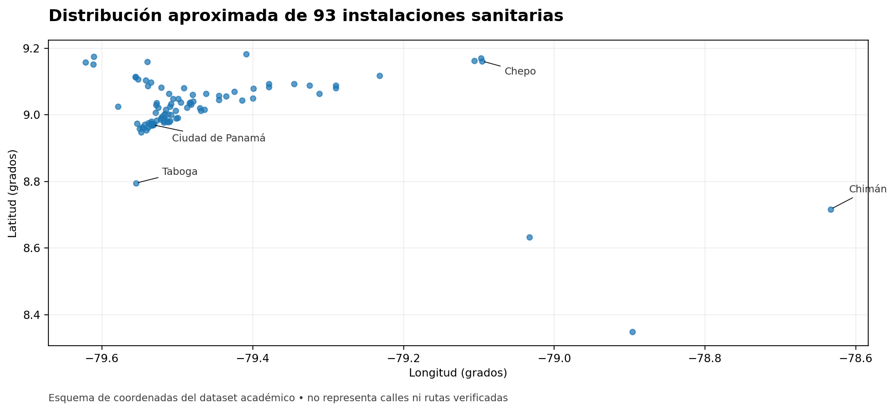

# Rutas de Acceso a Salud — Panamá

**Laboratorio académico de algoritmos de rutas y análisis geoespacial** · Python · Dijkstra · grafos · OpenStreetMap

> **Aviso:** proyecto educativo/experimental. **No utilizar para emergencias médicas, derivaciones de pacientes ni decisiones clínicas.** Las ubicaciones y horarios pueden ser aproximados o estar desactualizados; el tráfico es sintético y las rutas externas dependen de terceros.



## ¿Qué problema explora?

Comparar estrategias para encontrar rutas hacia instalaciones de salud de la provincia de Panamá, distinguiendo distancias teóricas, estimaciones de tránsito y rutas sobre calles obtenidas a través de servicios externos.

Este repositorio fue **preparado a partir del código académico existente**, conservando el motor original y añadiendo documentación, pruebas de humo, archivos para Git y CI. No representa una plataforma de atención médica desplegada.

### Evidencia verificada

| Indicador | Resultado reproducido localmente |
| --- | ---: |
| Instalaciones del dataset incluido | **93** |
| Pruebas internas | **38 / 38 correctas** |
| Errores de validación del dataset | **0** |
| Avisos de validación | **7** |
| Observaciones informativas | **2** |

**Interpretación:** el archivo original se entregó con nombre «v4.1», pero su constante interna todavía indica `4.0-laboratorio`; no cambié esa identificación para conservar el código. Las pruebas son **internas**, algunas usan simulaciones de servicios. No verifican la exactitud de todas las instalaciones ni constituyen auditoría clínica o certificación de rutas reales.

## Funcionalidades identificadas en el código

- Visualización de instalaciones y consultas de trayectos en un mapa interactivo local.
- **Dijkstra** sobre un grafo entre centros de salud; construcción mediante vecinos próximos y árbol de expansión mínima para conectar la red.
- Comparación entre distancia directa, estimación de rutas por calles y rutas devueltas por **OSRM** cuando esté disponible.
- Laboratorio opcional con **Dijkstra, Bellman-Ford, A*, BFS**, colas FIFO y montículos propios.
- Experimentos de congestión **sintética**, cierres de segmentos, benchmarks y consultas de segmentos **OSM/Overpass** bajo condiciones limitadas.
- Consultas desde la terminal, validación y exportación JSON/CSV; generación de PDF opcional.
- Servidor HTTP local con protección básica de las operaciones de escritura mediante token.

## Ejecutarlo en Windows / Linux / macOS

Requiere **Python 3.11 o superior**. El flujo básico utiliza la biblioteca estándar, por lo que no necesita instalar dependencias de pip.

```bash
cd rutas-salud-panama-dijkstra
python rutas_salud_panama.py --sin-osrm
```

**Nota:** descomprime el ZIP y entra a su carpeta antes de ejecutar los comandos. Cuando se publique el repositorio, agregaremos aquí el enlace real para clonarlo. El comando `python` puede ser `py` en Windows o `python3` en Linux/macOS.

El programa mostrará una URL local (por ejemplo `http://127.0.0.1:PUERTO/`). Se recomienda conservar el valor predeterminado `--host 127.0.0.1`. El mapa web necesita Internet para descargar Leaflet y el fondo de OpenStreetMap; `--sin-osrm` evita consultar OSRM, pero no descarga localmente esos recursos del navegador.

Para iniciar el modo de calles externo (requiere conexión e implica consultar servicios externos):

```bash
python rutas_salud_panama.py
```

### Reproducir los resultados sin Internet

```bash
python rutas_salud_panama.py --autotest
python rutas_salud_panama.py --validar
python rutas_salud_panama.py --sin-osrm --consulta "8.98,-79.52" --top 3
python -m unittest discover -s tests -v
```

La consulta de muestra usa una coordenada pública aproximada para ilustrar el algoritmo. **No es una recomendación de atención médica.**

### PDF opcional

```bash
python -m pip install -r requirements-pdf.txt
python rutas_salud_panama.py --validar --pdf informe_validacion.pdf
```

Si decides crear correcciones locales o generar el `index.html`, `.gitignore` evitará que se incluyan en el primer commit. No subir resultados de verificación de ubicaciones sin revisarlos.

## Tecnologías

- Python 3: grafos, búsqueda, estadísticas, validación y servidor HTTP local.
- HTML, CSS, JavaScript y Leaflet: mapa y controles (generados desde el script Python).
- OSRM, OpenStreetMap, Nominatim, Overpass: **servicios externos opcionales**, sujetos a conectividad, disponibilidad y políticas de uso.
- ReportLab: instalación opcional para informes PDF.
- `unittest` y GitHub Actions: pruebas externas y ejecución automatizada de CI.

## Documentación

- [Caso de estudio y competencias demostradas](docs/CASO_DE_ESTUDIO.md)
- [Arquitectura y métodos](docs/ARQUITECTURA.md)
- [Metodología, datos y limitaciones](docs/METODOLOGIA_Y_LIMITACIONES.md)
- [Cómo se verificó](docs/PRUEBAS.md)
- [Seguridad, privacidad y uso responsable](docs/SEGURIDAD.md)
- [Créditos, origen y permisos pendientes](CREDITOS.md)
- [Guía para publicar en GitHub](docs/PUBLICAR_EN_GITHUB.md)

## Autoría y condición de publicación

Proyecto académico atribuido provisionalmente al portafolio de **Emmanuel Trejos**. **Antes de hacerlo público**, confirmar personas colaboradoras, autorización para compartir código y datos, y restricciones relacionadas con la publicación científica. Consulta [CREDITOS.md](CREDITOS.md).

No se ha elegido una licencia de código abierto: todos los derechos permanecen con sus titulares hasta que estos autoricen una licencia. La inclusión en GitHub no implica permiso para copiar o reutilizar el código.

---

## English summary

**Academic routing and graph-algorithms laboratory for healthcare facilities in Panama.** The included dataset contains 93 facility records. In a local offline verification, the software passed **38/38 built-in checks** and reported **0 validation errors, 7 warnings, and 2 informational observations**. Features include Dijkstra-based graph routing, comparisons with Bellman-Ford, A* and BFS, synthetic congestion experiments, a local interactive map, and optional OSM/OSRM queries. External route and geolocation accuracy have **not** been independently validated.

**Safety:** educational prototype only; **not** suitable for medical emergencies, dispatch, clinical decisions, or real-time navigation. Python 3.11+; the CLI self-tests use only the standard library. Contributor permissions and publication status must be confirmed before public release.
