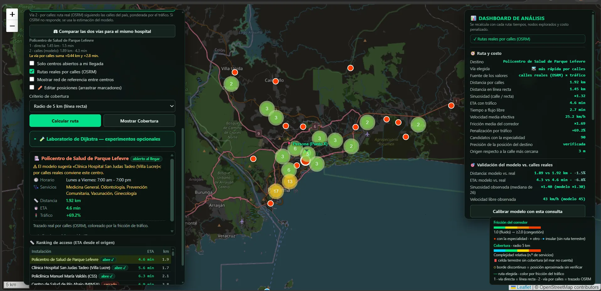

# Rutas de acceso a salud · Panamá

**Prototipo de investigación en Python** para estudiar algoritmos de camino mínimo y estructuras de datos aplicados a un conjunto de instalaciones de salud de la provincia de Panamá. El proyecto fue desarrollado como trabajo académico de equipo en la Universidad Tecnológica de Panamá (UTP).

> **Importante:** Herramienta de investigación y docencia. El modelo de tráfico es **sintético**; la aplicación **no** proporciona información clínica ni se debe utilizar para determinar rutas de emergencia. Las instalaciones y horarios requieren verificación independiente.



## ¿Qué contiene?

- **Dijkstra** con cola de prioridad (montículo mínimo) implementada en Python.
- **BFS** con cola FIFO propia como comparación de menor cantidad de saltos.
- **Floyd–Warshall** para caminos mínimos entre todos los pares del grafo hospitalario abstracto.
- Grafo de instalaciones con proximidad geográfica + árbol de expansión mínima.
- Laboratorio opcional de segmentos dirigidos de **OpenStreetMap** (Overpass) para recorridos locales.
- Consultas de ruta por distancia/tiempo, bloqueos simulados, escalabilidad y comparación técnica con OSRM.
- Visualización cartográfica local, exportaciones y **40 pruebas internas**.

## Resultados documentados

| Prueba | Resultado | Alcance |
|---|---|---|
| Calles OpenStreetMap | 10 casos; media computacional de 37,29 ms | Subgrafos viales descargados en los experimentos |
| Distancia frente a tiempo | Selección de caminos distintos en 6/10 casos | Ponderaciones y tráfico simulado |
| Segmento bloqueado | Ruta alternativa en 10/10 casos | Solo los diez casos probados |
| Dijkstra vs. Floyd–Warshall | Igual costo mínimo en los 10 casos | Grafo hospitalario abstracto |
| Pruebas internas | 40/40 | Suite integrada en el script |

Los números describen **experimentos concretos**, no garantías generales de rendimiento ni precisión vehicular.

## Requisitos

- **Python 3.10 o superior**; núcleo basado en biblioteca estándar.
- Navegador moderno (Edge/Chrome/Firefox).
- Internet para OpenStreetMap, Overpass y OSRM; algunos experimentos no lo requieren.
- Opcional: `pip install -r requirements-optional.txt` para informes PDF enriquecidos.

## Ejecutar en Windows

1. Descarga el repositorio en ZIP desde **Code → Download ZIP** en GitHub y extráelo.
2. Instala Python si no lo tienes.
3. Haz doble clic en **`INICIAR_RUTAS.bat`**.
4. El mapa se abrirá en tu navegador local, con una dirección similar a `http://127.0.0.1:60655`.
5. Abre **Laboratorio de Dijkstra** y pulsa **Comparar Dijkstra, BFS y Floyd-Warshall**.

En Linux/macOS: `sh INICIAR_RUTAS.sh` o `python3 src/rutas_salud_panama_floyd.py`.

```bash
python src/rutas_salud_panama_floyd.py --autotest
python src/rutas_salud_panama_floyd.py --validar
python scripts/reproducir_comparacion_tres_algoritmos.py
```

El último comando guarda resultados nuevos en `results/reproduccion/`, sin sobrescribir los archivos experimentales publicados aquí. Los tiempos variarán entre equipos.

## Artículo científico

**Shortest-Path Evaluation for Healthcare Access in Panama: Dijkstra, BFS, and Floyd–Warshall Across Two Graph Models**

- [Leer artículo completo (PDF)](paper/Articulo_Dijkstra_V4_Tres_Algoritmos_EN_APA.pdf)
- [Descargar manuscrito editable (Word)](paper/Articulo_Dijkstra_V4_Tres_Algoritmos_EN_APA.docx)
- [Comparación de tres algoritmos (CSV)](results/Comparacion_Dijkstra_BFS_Floyd_10_Casos.csv)
- [Casos viales documentados (CSV)](results/Casos_Verificados_Dijkstra_v41.csv)
- [Exportaciones primarias (ZIP)](data/raw/Experimentos_Djistraka.zip)
- [Cómo reproducir la investigación](docs/REPRODUCIBILIDAD.md)

**Autores que figuran en el manuscrito:** Emmanuel Trejos, Rolando Montero, Jorge Isaac Abadia y Oswel Cardona. **Estado:** borrador de manuscrito académico; no se afirma aceptación o publicación por una revista.

## Demostración web para Vercel

El directorio [`site/`](site/) contiene una **presentación pública estática** con una comparación interactiva real de los tres algoritmos sobre un grafo *sintético pequeño*. **No es** la aplicación completa ni el laboratorio OSM; esos requieren iniciar el Python en local.

Para publicar por primera vez, sigue [Publicar en GitHub](docs/PUBLICAR_EN_GITHUB.md) y después [Despliegue en Vercel](docs/DESPLIEGUE_VERCEL.md).

## Estructura del proyecto

```text
├── src/                 Código Python original
├── scripts/             Reproducción científica
├── paper/               Manuscrito en PDF y DOCX
├── results/             CSV y JSON de resultados
├── data/raw/            Evidencias exportadas originales
├── docs/                Metodología, reproducibilidad, despliegue
├── site/                Página demostrativa para Vercel
├── .github/workflows/   Pruebas automáticas
└── INICIAR_RUTAS.bat     Lanzador para Windows
```

## Créditos, datos y uso responsable

- Cartografía y datos viales: **© OpenStreetMap contributors** (licencia ODbL, con atribución conforme a sus requisitos).
- Motor de referencia: **OSRM**; sus estimaciones no son tráfico real observado.
- El código del equipo y el artículo **no cuentan todavía con licencia abierta acordada por los autores**; por lo tanto, publicar el repositorio no equivale a conceder permisos de reutilización. Antes de elegir una licencia deben consultarlo con todos los integrantes.
- Para incidencias o solicitudes académicas, utilizar las herramientas de contacto del repositorio una vez publicado.

## Estado del proyecto

Prototipo académico documentado y probado localmente. Próximos pasos: revisión final del artículo, publicación del repositorio, despliegue de la demostración y verificación de enlaces.
